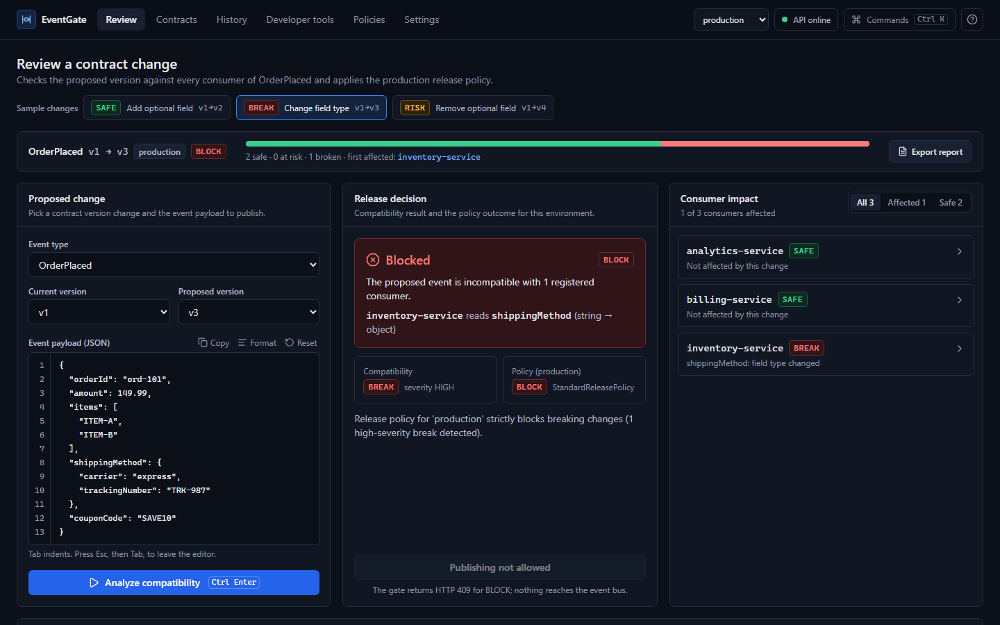
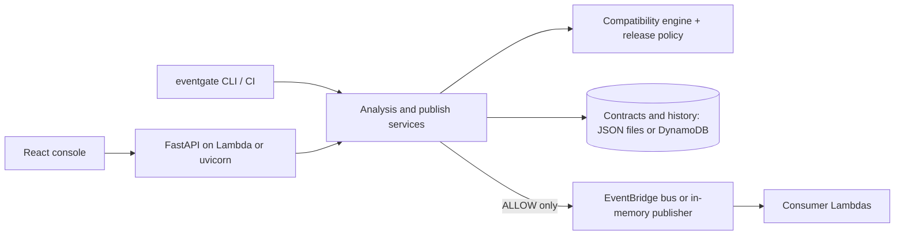

# EventGate

EventGate checks a proposed version of an event contract against the fields every downstream consumer reads, and decides per environment whether the change may ship: **ALLOW**, **REVIEW** or **BLOCK**. Its publish endpoint only forwards an event to the bus when the decision is ALLOW.



Live deployment (AWS, `ap-south-1`): console at <https://main.d1etyxeqf0w3wz.amplifyapp.com>, API at <https://ux8bwi3i8l.execute-api.ap-south-1.amazonaws.com>. The deployment reflects `main` as of its last `sam deploy`.

## Why

A producer can validate its own payloads and still break a consumer: if `OrderPlaced.shippingMethod` changes from `string` to `object`, the producer's schema check passes and `inventory-service` fails at runtime. EventGate compares the change with each consumer's declared expectations, so only consumers that read a changed field are flagged, and a change nobody reads is allowed.

## Quick start (local, no AWS needed)

Requires Python 3.12+ and Node.js 20.19+ (or 22+).

```bash
python -m venv .venv
source .venv/bin/activate            # Windows: .venv\Scripts\activate
pip install -e ".[dev]"
uvicorn eventgate.main:app --port 8000
```

In a second terminal:

```bash
cd frontend
npm ci
npm run dev                          # http://localhost:5173, talks to http://127.0.0.1:8000
```

Open <http://localhost:5173>, pick a sample change and press **Analyze compatibility**. Locally, contracts come from `contracts/`, history is written to `.eventgate/history.json` (gitignored) and published events go to an in-memory publisher that logs them. API docs are at <http://127.0.0.1:8000/docs>.

The same engine is available from the command line:

```bash
eventgate check --event OrderPlaced --current 1 --proposed 3 --env production   # exit 1: BLOCK
```

## How it works



1. **Diff.** Load the current and proposed contract and compute added, removed, retyped and requiredness-changed fields.
2. **Per-consumer check.** For each consumer subscribed to the event, apply the rules below to the fields that consumer declares. Fields it does not read never affect it.
3. **Verdict.** Any BREAK makes the change BREAK (severity HIGH); otherwise any RISK makes it RISK (MEDIUM); otherwise SAFE (LOW). An event with no registered consumers is treated as RISK, because nobody can vouch for it.
4. **Policy.** The environment decides what the verdict means:

   | Environment | SAFE | RISK | BREAK |
   | --- | --- | --- | --- |
   | production | ALLOW | REVIEW | BLOCK |
   | staging | ALLOW | REVIEW | BLOCK |
   | development | ALLOW | ALLOW with warning | BLOCK |

5. **Gate.** `POST /api/v1/events/publish` validates the payload against the proposed contract, re-runs the analysis and publishes only on ALLOW; BLOCK and REVIEW return HTTP 409 and the bus is never called.
6. **Audit.** Every analysis and publish attempt is stored as a release record keyed by the analysis ID, so a publish is recorded on the same entry as the analysis that justified it.

| Rule | Result | When it fires for a consumer |
| --- | --- | --- |
| EVT001 field type changed | BREAK | a field it reads changes to a type it cannot accept (a consumer reading `number` accepts `integer`) |
| EVT003 required field missing | BREAK | a field it requires is absent from the proposed contract |
| EVT004 requiredness changed | BREAK | a field it reads switches between required and optional |
| EVT006 optional field removed | RISK | a field it reads optionally is removed |
| EVT005 optional field added | SAFE | only optional fields it does not read were added |
| EVT008 consumer unaffected | SAFE | no change touches its fields |

More detail: [docs/architecture.md](docs/architecture.md).

## Tech stack

- **Backend:** Python 3.12+, FastAPI, Pydantic, Mangum (Lambda adapter), boto3, Click (CLI), cedarpy (optional Cedar policy engine).
- **Frontend:** React 19, TypeScript (strict), Vite, Tailwind CSS 4, TanStack Query, Zod, @xyflow/react.
- **AWS (SAM, `template.yaml`):** API Gateway HTTP API, Lambda (Python 3.14), three DynamoDB tables, an EventBridge bus with three demo consumer Lambdas, Amplify Hosting for the console.
- **Testing:** pytest, moto, Vitest, Testing Library, Playwright, axe-core, Locust, mypy, ruff, oxlint.

## Design decisions and trade-offs

- **Rules are deterministic and consumer-scoped.** The same inputs always produce the same findings, and consumers only see changes to fields they declared. The cost is that consumers must maintain their contracts; an event with none is held for review.
- **Compatibility and policy are separate.** The engine reports what a change does; the policy decides what to do about it per environment. A Cedar policy (`backend/src/eventgate/policies/release_policy.cedar`) implements the same matrix and can be switched on with `EVENTGATE_POLICY_ENGINE=cedar`.
- **Ports and adapters.** Services depend on repository and publisher interfaces, with JSON/in-memory adapters for local use and DynamoDB/EventBridge adapters for AWS. The whole stack runs offline and the tests need no credentials.
- **No table scans.** DynamoDB access is by key or GSI; listing all event types or consumers reads a `METADATA#CATALOG` item that `scripts/seed_dynamodb.py` maintains.
- **One FastAPI app, two runtimes.** uvicorn locally, Mangum on Lambda. Lambda keeps idle cost at zero at the price of cold starts.

The full records are in [docs/decisions.md](docs/decisions.md).

## Configuration

All variables are optional; the defaults run everything locally. See [.env.example](.env.example).

| Variable | Default | Purpose |
| --- | --- | --- |
| `EVENTGATE_STORAGE_BACKEND` | `local` | `local` (JSON files) or `dynamodb` |
| `EVENTGATE_EVENT_PUBLISHER` | `local` | `local` (in-memory) or `eventbridge` |
| `EVENTGATE_POLICY_ENGINE` | `standard` | `standard` or `cedar` |
| `EVENTGATE_CONTRACTS_DIR` | `contracts/` | Local contract files |
| `EVENTGATE_HISTORY_FILE` | `.eventgate/history.json` | Local release history file |
| `EVENTGATE_PERSIST_HISTORY` | unset | CLI: record history without `--persist` |
| `EVENT_CONTRACTS_TABLE_NAME`, `CONSUMER_CONTRACTS_TABLE_NAME`, `RELEASE_HISTORY_TABLE_NAME` | dev stack names | DynamoDB tables |
| `EVENTBRIDGE_BUS_NAME` | `primex-eventgate-dev-bus` | Bus for ALLOWed events |
| `AWS_REGION` | `ap-south-1` | Region for DynamoDB and EventBridge |
| `VITE_EVENTGATE_API_URL` (frontend) | dev: `http://127.0.0.1:8000`, build: deployed API | API base URL for the console |

## API

| Method | Path | Purpose |
| --- | --- | --- |
| GET | `/health` | Liveness and version |
| POST | `/api/v1/analyze` | Analyze a version change; records it in history |
| POST | `/api/v1/events/publish` | Validate the payload, re-analyze, publish only on ALLOW (409 on BLOCK/REVIEW) |
| GET | `/api/v1/contracts/events` | Event types with versions and consumer counts |
| GET | `/api/v1/contracts/events/{eventType}` | All versions of one event and its consumers |
| GET | `/api/v1/contracts/consumers` | Registered consumers |
| GET | `/api/v1/contracts/consumers/{consumerId}` | Fields one consumer expects |
| GET | `/api/v1/history` | Release records, newest first (`eventType`, `limit` filters) |
| GET | `/api/v1/history/{recordId}` | One record, by record or analysis ID |
| GET | `/api/v1/history/{recordId}/report?format=markdown\|json` | A record rendered as a report |
| GET | `/api/v1/policies` | Active policy engine, decision matrix and Cedar source |
| GET | `/api/v1/config/runtime` | Adapters the API is running with |

Errors share one shape, `{"error": {"code", "message", "requestId", "details?"}}`, and every response carries `X-Request-ID`. Request and response examples are in [docs/api.md](docs/api.md); the CLI is described in [docs/cli.md](docs/cli.md).

## Tests

One command runs everything CI runs (lint, type checks, unit and integration tests with coverage, production build, backend HTTP end-to-end, Playwright end-to-end):

```bash
python scripts/check.py              # add --skip-e2e to skip both end-to-end suites
```

The backend end-to-end suite needs Docker (it starts DynamoDB Local); the first Playwright run needs `npx playwright install chromium` in `frontend/`. What each suite covers, the latest results and the manual checks are in [docs/TESTING.md](docs/TESTING.md).

| Layer | Command | Count | Coverage |
| --- | --- | --- | --- |
| Backend unit + integration (pytest, moto for DynamoDB/EventBridge) | `pytest --cov=eventgate` | 426 | 99.8% of statements |
| Frontend components, hooks, API client (Vitest + Testing Library) | `npm run test:coverage` | 168 | 96.9% of lines |
| Backend over HTTP: uvicorn with local storage and with DynamoDB Local | `python scripts/run_backend_e2e.py` | 45 | - |
| Browser end-to-end + axe accessibility, desktop and mobile Chromium | `npm run test:e2e` | 62 (59 run, 3 desktop-only) | - |

Load test (Locust, 20 concurrent users for 60 s against local uvicorn with the JSON history store, measured at commit 026c35d): 26.6 req/s, p50 95 ms, p95 310 ms, 0 errors. The deployed API uses DynamoDB, so this figure does not describe it.

```bash
locust -f perf/locustfile.py --host http://127.0.0.1:8000 --headless -u 20 -r 5 -t 60s
```

CI (`.github/workflows/ci.yml`) runs the backend on Python 3.12 and 3.14, the frontend on Node 22, then the backend HTTP suite and the Playwright suite, on every push and pull request, and uploads JUnit and coverage reports from each job. AWS calls are emulated with moto or DynamoDB Local, so CI needs no secrets. A second workflow, `eventgate-contract-check.yml`, runs the release gate on pull requests that change files under `contracts/`.

## Deployment

```bash
sam build && sam deploy                       # stack primex-eventgate-dev in ap-south-1 (samconfig.toml)
python scripts/seed_dynamodb.py --region ap-south-1
python scripts/aws_smoke_test.py <ApiUrl>
```

Amplify builds `frontend/` with `amplify.yml` on every push to `main` and adds the response headers in `customHttp.yml`. Step-by-step instructions, including the live enforcement smoke test, are in [docs/deployment.md](docs/deployment.md).

## Known limitations

- **No authentication.** The deployed API is public. HTTP API throttling (20 req/s, burst 40) limits abuse, but anyone can publish an ALLOWed event to the dev bus.
- **One event type per consumer.** A consumer contract subscribes to exactly one event type (`consumerId` is the table key).
- **Top-level fields only.** The diff and payload validation look at top-level fields and JSON types; nested object schemas, enums and formats are not compared.
- **Local storage is single-process.** The JSON history store is locked per process and rewrites one file; it is meant for development and CI, not for several API processes sharing a file.
- **The CI gate compares adjacent versions in the working tree.** Editing an already-published version in place is not detected as a change against the base branch.

## Project layout

```text
backend/src/eventgate/   API (api/), use cases (application/), rules and policy (domain/),
                         JSON/DynamoDB/EventBridge adapters (infrastructure/), CLI (cli/)
backend/tests/           pytest unit and integration tests
consumers/src/           Demo consumer Lambda that logs delivered events
contracts/               Event and consumer contracts used locally and for seeding
frontend/                React console; e2e/ holds the Playwright tests
scripts/                 check.py, DynamoDB seeding, CI contract diff, AWS smoke tests
perf/                    Locust load profile
template.yaml            AWS SAM stack
```

## License

MIT, see [LICENSE](LICENSE).
