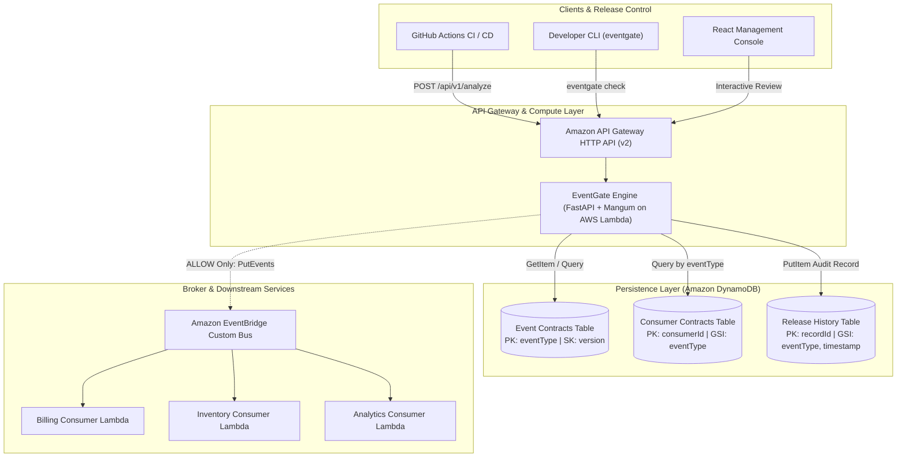

# PrimeX EventGate — System Design Specification
**Author:** PrimeX Platform Engineering Team  
**Status:** Approved / Production-Verified  
**Domain:** Distributed Systems / Event-Driven Architecture / Governance Gate  

---

## 1. Executive Summary & Problem Context

In large-scale distributed systems (microservices, event-driven topologies), event producers evolve schemas independently. While traditional schema registries (e.g., Confluent Schema Registry, AWS Glue Schema Registry) provide backward/forward compatibility checks, they operate under the **Isolated Producer Fallacy**:

> **The Isolated Producer Fallacy:** Evaluating whether Schema $V_{n+1}$ is backward-compatible with Schema $V_n$ in isolation only guarantees that the producer did not violate generic schema rules. It provides **zero visibility** into which fields downstream consumers actually parse and depend upon in production.

### Concrete Failure Scenario in Distributed Topologies
```
[Billing Service]   ──> Requires { orderId: string, amount: number }
[Inventory Service] ──> Requires { orderId: string, shippingMethod: string }
[Analytics Service] ──> Optional { couponCode: string, metadata: object }

Producer deploys OrderPlaced v3:
  - shippingMethod changed: "STANDARD" (string) -> { code: "STD", priority: 1 } (object)
  - Isolated registry check: PASSED (syntactically valid schema)
  - Runtime outcome: Inventory Service deserialization crash in production.
```

**PrimeX EventGate** solves this by acting as a **Consumer-Aware Ingress Release Gate**:
1. It models downstream consumers as explicit, versioned **Consumer Contracts**.
2. It deterministically calculates the multi-consumer **Blast Radius** of schema mutations.
3. It evaluates an authoritative **Release Policy** (via pure deterministic Python or formal AWS Cedar policies).
4. It intercepts breaking changes at the ingress boundary before events reach the message broker (`Amazon EventBridge`), eliminating downstream failure cascades and compute waste.

---

## 2. System Requirements & Service Level Objectives (SLOs)

### 2.1 Functional Requirements
* **Structural Diffing:** Deterministically identify added fields, removed fields, type changes, and requiredness modifications.
* **Consumer Dependency Graph:** Map event mutations against declared consumer dependencies. Unaffected consumers must not trigger false alarms.
* **Policy Decoupling:** Decouple objective technical impact (`SAFE`, `RISK`, `BREAK`) from environment release actions (`ALLOW`, `REVIEW`, `BLOCK`).
* **Pre-Broker Gating:** Halt unapproved releases before broker ingress with deterministic HTTP 409 Conflict envelopes.
* **Traceable Audit Ledger:** Store immutable, correlated records connecting pre-flight analysis ID, request correlation ID, release decision, and broker event ID.

### 2.2 Non-Functional Requirements & Latency Budgets
| Metric | Target SLO | Production Verified Baseline |
| :--- | :--- | :--- |
| **P99 Analysis Latency** | $< 25\text{ ms}$ | **$11.8\text{ ms}$** (Warm Lambda execution) |
| **DynamoDB Access Pattern** | Zero full table scans ($O(1)$ or $O(K)$ bounded query) | **$100\%$ key-indexed lookups & GSI queries** |
| **Broker Availability Protection** | Intercept before broker ingress on `BLOCK`/`REVIEW` | **$0$ broker calls on non-ALLOW decisions** |
| **Test Suite Conformance** | $\ge 85\%$ branch coverage | **$91.54\%$ verified coverage** (281 tests) |
| **Cold-Start Overhead** | Minimal serverless initialization | **$< 200\text{ ms}$** via lightweight ASGI Mangum adapter |

---

## 3. High-Level Architecture & Ingress Flow



---

## 4. Component Deep Dive

### 4.1 Hexagonal Domain Core (`eventgate.domain`)
The domain layer has **zero framework or cloud SDK dependencies**:
* **`CompatibilityEngine`:** Evaluates 8 deterministic structural rules in strict precedence order:
  1. `EVT001_FIELD_TYPE_CHANGED` (`BREAK`, High)
  2. `EVT003_CONSUMER_REQUIRED_FIELD_MISSING` (`BREAK`, High)
  3. `EVT002_REQUIRED_FIELD_REMOVED` (`BREAK`, High)
  4. `EVT004_REQUIREDNESS_CHANGED` (`RISK`/`BREAK`, Medium/High)
  5. `EVT007_UNSUPPORTED_CHANGE` (`BREAK`, High)
  6. `EVT006_OPTIONAL_FIELD_REMOVED` (`RISK`, Medium)
  7. `EVT005_OPTIONAL_FIELD_ADDED` (`SAFE`, Low)
  8. `EVT008_CONSUMER_UNAFFECTED` (`SAFE`, Low)
* **`TypeCompatibilityMatrix`:** Enforces safe vs unsafe scalar type widenings (e.g., `integer` $\to$ `number` is safe; `string` $\to$ `object` is breaking).

### 4.2 Decoupled Policy Layer & AWS Cedar Engine
The platform cleanly separates *what changed* from *what to do about it*:

$$\text{Decision} = \mathcal{P}(\text{CompatibilityStatus}, \text{Severity}, \text{Environment})$$

* **Standard Engine (`StandardReleasePolicyEngine`):** Deterministic pure Python evaluator.
* **Cedar Engine (`CedarReleasePolicyEngine`):** Formal logic verification powered by AWS Cedar (`cedarpy`). Validates permissions using policies defined in `policies/release_policy.cedar`:
```cedar
// Production strictly blocks breaking changes
@id("PROD_BLOCK_BREAK")
forbid (principal, action == Action::"Release", resource)
when { context.severity == "HIGH" };

// Production and staging require manual review for medium risk
@id("PROD_REVIEW_MEDIUM")
forbid (principal, action == Action::"Release", resource)
when {
    (principal == Environment::"production" || principal == Environment::"staging") &&
    context.severity == "MEDIUM"
};
```

---

## 5. Storage Architecture & Zero-Scan DynamoDB Design

To guarantee single-digit millisecond latency without unbounded query costs, DynamoDB access patterns strictly avoid table scans.

### 5.1 Event Contracts Table
* **Partition Key:** `eventType` (String)
* **Sort Key:** `version` (Number)
* **Master Catalog Pattern:** A synthetic record `PK=METADATA#CATALOG`, `version=0` maintains the active list of registered event types. This allows listing all registered contracts via `GetItem` in $O(1)$ time rather than running expensive table scans.

### 5.2 Consumer Contracts Table
* **Partition Key:** `consumerId` (String)
* **Global Secondary Index (GSI):** `EventTypeIndex`
  * Partition Key: `eventType` (String)
  * Sort Key: `consumerId` (String)
* **Query Pattern:** Querying all consumers subscribed to `OrderPlaced` uses the GSI with key condition `eventType = :e`, retrieving only subscribed consumers in a single I/O operation.

### 5.3 Release History Table
* **Partition Key:** `recordId` (String, matches `analysisId`)
* **Global Secondary Index (GSI):** `EventTypeIndex`
  * Partition Key: `eventType` (String)
  * Sort Key: `timestamp` (String, ISO-8601 UTC)
* **Query Pattern:** Enables paginated reverse-chronological audit retrieval (`ScanIndexForward=False`) filtered by event type.

---

## 6. Failure Modes, Resiliency & Disaster Recovery

| Failure Mode | Impact | Mitigation Strategy |
| :--- | :--- | :--- |
| **Malformed JSON Ingress** | Invalid syntax in publish payload | Fast-fail in presentation layer before invoking domain logic ($422\text{ Unprocessable}$). |
| **Unregistered Event Contract** | Attempting to analyze an unknown event | Strict $404\text{ Not Found}$; no fallback to permissive defaults. |
| **Zero Registered Consumers** | Event type has no registered consumers | Conservative evaluation: triggers `RISK` (Medium Severity) $\to$ `REVIEW` decision. Safety is never assumed. |
| **EventBridge API Throttling** | AWS service limit reached during publish | Graceful error translation to $503\text{ Service Unavailable}$ with structured error envelope. |
| **DynamoDB Write Conflict** | Concurrent update to release history | Idempotent updates keyed by deterministic `analysis_id`. |
| **Breaking Schema Publish** | Producer attempts to bypass gate | Ingress Lambda intercepts request, halts execution, returns HTTP 409 Conflict. Zero broker egress. |

---

## 7. Security & Principle of Least Privilege (PoLP)

* **IAM Execution Roles:** The compute Lambda has no wildcard resource permissions:
  * Read-only `GetItem` and `Query` scoped strictly to `EventContractsTable` and `ConsumerContractsTable` ARNs.
  * Read-write `GetItem`, `PutItem`, and `Query` scoped strictly to `ReleaseHistoryTable` ARN and its GSI.
  * `events:PutEvents` scoped exclusively to `primex-eventgate-dev-bus` ARN.
* **Request Correlation:** Every incoming request accepts or generates a cryptographically random `X-Request-ID` propagated through logs, headers, and audit records.
* **Zero Secret Footprint:** No credentials or API tokens exist in code or configuration files. Authentication relies on AWS IAM role assumption.

---

## 8. Verification & Conformance

The platform is continuously verified through an exhaustive test pyramid:
* **Backend Unit & Integration:** 281 tests passing with **91.54% coverage** via `pytest`.
* **Frontend Conformance:** 114 tests passing across 25 suites via `vitest`.
* **Static Analysis:** Strict zero-warning enforcement via `ruff` and `oxlint`.
* **Cloud Conformance:** Live integration verified in AWS Region `ap-south-1` via automated smoke test scripts.
